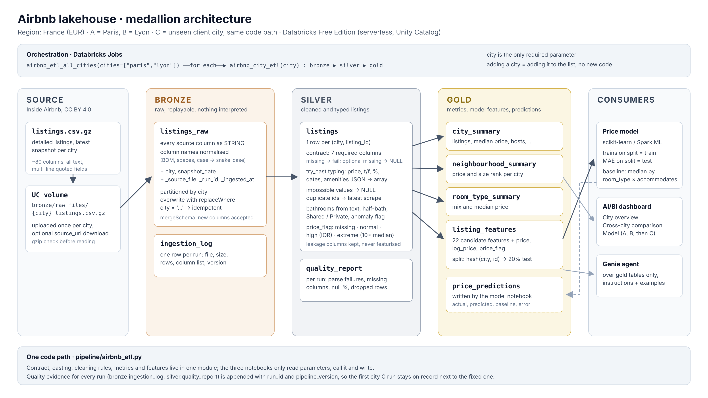

# Airbnb Lakehouse Analytics

Group Assignment 2 — Big Data

## Project Overview
Airbnb data analytics using Databricks.

## Objectives
- Exploratory Data Analysis
- Bronze, Silver, Gold lakehouse architecture
- ETL pipeline
- Price prediction model
- AI/BI dashboard
- Genie Agent
- Evaluation on an unseen city

## Region and cities

Region **France**, currency **EUR**. Data: [Inside Airbnb](https://insideairbnb.com/get-the-data/) detailed `listings.csv.gz` (CC BY 4.0).

| Role | City | `city` parameter | Snapshot date |
|---|---|---|---|
| A (training) | Paris | `paris` | 2026-09-16 |
| B (training) | Lyon | `lyon` | 2026-09-17 |
| C (new client) | Bordeaux | `bordeaux` | 2026-09-17 |

## Architecture

Medallion lakehouse in Unity Catalog `airbnb_lakehouse`: raw files in **bronze**, cleaned and typed listings in **silver**, metrics, model features and predictions in **gold**. Details, table contracts and design decisions: [docs/architecture.md](docs/architecture.md).



## ETL pipeline

One pipeline, the city is a parameter. All logic is in `pipeline/airbnb_etl.py`; the notebooks `01_bronze_ingest` → `02_silver_listings` → `03_gold_tables` are the job tasks.

| Job | What it does |
|---|---|
| `airbnb_city_etl` | bronze → silver → gold for one `city` |
| `airbnb_etl_all_cities` | runs `airbnb_city_etl` for each city in `cities` (default `["paris", "lyon"]`) |

Run it:

1. Upload each city's file to `/Volumes/airbnb_lakehouse/bronze/raw_files/<city>_listings.csv.gz`.
2. `databricks bundle deploy`, then `databricks bundle run airbnb_etl_all_cities` (or create the jobs in the UI as described in [docs/architecture.md](docs/architecture.md#jobs)).
3. `pipeline/04_run_report` shows what each run produced.

Adding a city means uploading its file and adding its name to `cities`; no code is copied.

## City C

Bordeaux evaluation: [docs/bordeaux_evaluation.md](docs/bordeaux_evaluation.md).
Measured first-run model results: [docs/model_evaluation_report.md](docs/model_evaluation_report.md).

## Price prediction

Run `notebooks/02_price_prediction.py` in Databricks after the A/B ETL.
Feature rationale, evaluation rules and findings are documented in the
[model evaluation report](docs/model_evaluation_report.md).
The reusable model is in `model/price_model.py`; dashboard queries are in
`model/dashboard_queries.sql`.

Databricks evaluation results for run `france_v1`:

| Evaluation | Labeled listings | Model MAE (EUR) | Baseline MAE (EUR) |
|---|---:|---:|---:|
| Paris test | 8,734 | 142.55 | 156.65 |
| Lyon test | 997 | 157.94 | 104.61 |
| A/B combined test | 9,731 | 144.13 | 151.32 |
| Bordeaux unchanged model | 7,722 | 223.16 | 118.51 |

Combined A/B MAE improves by 4.75% over the training-median baseline, but
the model performs worse in Lyon and Bordeaux. Bordeaux MAE is 54.8% higher
than combined A/B MAE; diagnostics show systematic overprediction.
Full methods, snapshot counts, room-type diagnostics, limitations and the
Gold output specifications are in [docs/model_evaluation_report.md](docs/model_evaluation_report.md).
Prediction coverage is verified for all three cities: Paris 77,149, Lyon 9,201 and Bordeaux 12,063 listings. Bordeaux has 12,063 unique listing IDs and 12,063 non-null predictions. No execution errors were recorded in the completed workflow; no revised model was evaluated.

### Running the model

1. Keep `model/price_model.py` alongside the `notebooks` folder in the Databricks Git project. Open `notebooks/02_price_prediction.py` from that folder. The notebook collects city data into driver memory; do not silently sample evaluation rows if memory is insufficient.
2. Use pandas, numpy, joblib and scikit-learn >=1.2. Preserve the exact dependency versions for Bordeaux. The notebook needs permission to read Gold tables, create the `gold.model_artifacts` volume and write output tables.
3. Complete `01_bronze_ingest` → `02_silver_listings` → `03_gold_tables` for Paris and Lyon. Verify `gold.listing_features` contains both cities with train/test rows and valid prices.
4. Run the model notebook with `mode=train_ab`, `catalog=airbnb_lakehouse` and a fresh `run_id`. The completed run uses `france_v1`; do not reuse it for training. Save per-city test metrics and the code revision before inspecting Bordeaux.
5. The notebook saves the frozen model, baseline, manifest and A/B metrics under `/Volumes/airbnb_lakehouse/gold/model_artifacts/<run_id>/`. Keep these artifacts; they are required for the unchanged-city evaluation.
6. Run the unchanged ETL for Bordeaux, recording its snapshot date and any failures. Set `mode=evaluate_c` and the original A/B run ID in the model notebook. This loads the frozen model without retraining and evaluates every valid-priced Bordeaux listing.
7. Outputs append to `gold.price_predictions` and `gold.model_metrics`. Filter one run ID; use only `ab_test` and `c_unseen` for accuracy charts. Predictions also cover rows without actual prices, whose errors cannot be measured.
8. Confirm one non-null prediction per city/listing/run/stage, matching feature-table counts. Save results and verify table read permissions. If a run fails after saving artifacts but before publishing tables, reconcile artifacts and tables before retrying; guards prevent overwriting first-run evidence.

Do not rerun the completed training merely to refresh documentation. Any revised model needs a new run ID. Tune only within A/B training data; after inspecting Bordeaux, label further Bordeaux evaluations as post-diagnosis results.

## Repository

```
notebooks/01_exploratory_analysis.ipynb  EDA on Paris and Lyon
notebooks/02_price_prediction.py        A/B training and frozen Bordeaux evaluation
model/price_model.py                   model and training-only median baseline
model/dashboard_queries.sql            dashboard queries
docs/model_evaluation_report.md                model evaluation results
pipeline/airbnb_etl.py                  shared ETL module
pipeline/01_bronze_ingest.py            job task 1
pipeline/02_silver_listings.py          job task 2
pipeline/03_gold_tables.py              job task 3
pipeline/04_run_report.py               read-only run report
resources/airbnb_etl.job.yml            job definitions
databricks.yml                          Databricks Asset Bundle root
docs/                                   architecture, city C report
```
